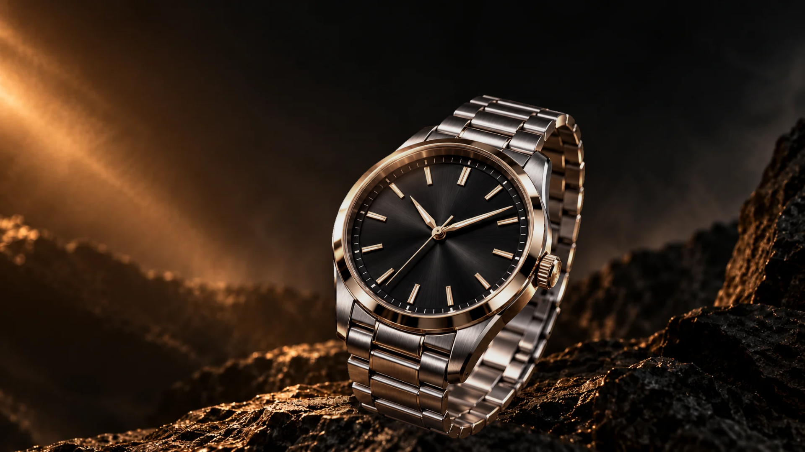

# Atelier — Tempo

Site de uma relojoaria fictícia, feito em HTML, CSS e JavaScript puros, sem frameworks e sem etapa de build. A abertura é um filme em que a **rolagem da página controla o tempo do vídeo**, nos dois sentidos: o relógio se desmonta camada por camada conforme você desce e se remonta quando você volta.



## Destaques

- **Filme guiado pela rolagem.** Uma trilha de 420vh dissolve a cena estática no primeiro quadro do vídeo e, depois disso, o tempo do vídeo acompanha a rolagem, suavizado a cada quadro, sem pedir um novo quadro enquanto o anterior ainda carrega.
- **Relógio sobre a palavra.** O título "TEMPO" fica atrás do relógio recortado (PNG/webp com transparência), reproduzindo as camadas da imagem de referência.
- **Menu inteligente.** Fundo escuro depois da abertura e item ativo seguindo a seção visível.
- **Entrada suave das seções**, desligada para quem prefere movimento reduzido.
- **Mobile de verdade.** O celular recebe um arquivo de vídeo próprio, com quadro-chave a cada 4 frames para a rolagem não engasgar, e um layout próprio para telas em pé.
- **Acessível e com degradação graciosa.** Sem JavaScript ou com `prefers-reduced-motion`, a abertura vira um hero estático e os capítulos viram seções comuns, sem vídeo.

## Estrutura da página

| Seção | Âncora | Conteúdo |
|---|---|---|
| Abertura | `#inicio` | Título, relógio e filme controlado pela rolagem, com os capítulos "Safira e luneta", "Mostrador" e "Calibre AT‑01" |
| Coleção | `#calibre` | "O coração à vista", o calibre em destaque |
| Galeria | `#angulos` | "Três ângulos" do relógio |
| Ofício | `#oficio` | "Uma bancada, três etapas", o processo de fabricação |
| Contato | `#contato` | "Reserve o seu Tempo 40", com chamada por e-mail |

## Como rodar

Não há dependências nem build. Basta servir a pasta com qualquer servidor estático:

```bash
python -m http.server 8080
```

Depois abra http://localhost:8080. Também funciona abrindo o `index.html` direto no navegador, mas o servidor local é mais fiel ao que roda na web (principalmente para o vídeo).

## Estrutura do projeto

```
.
├── index.html          Marcação da página
├── css/
│   ├── style.css       Estilos gerais, seções e responsividade
│   └── filme.css       Estilos da abertura com filme
├── js/
│   ├── site.js         Menu fixo, item ativo e entrada das seções
│   └── filme.js        Rolagem → tempo do vídeo
├── assets/
│   ├── *.webp          Imagens servidas pela página
│   ├── filme-*.mp4     Filme da abertura (desktop e celular)
│   └── src/            Originais em PNG usados para gerar os webp
├── clipes/             Clipe de rascunho do filme
├── reference/          Imagem alvo e o estudo de camadas e medidas
└── tools/              Scripts de captura, medição e teste (Python)
```

## Como a abertura funciona

`js/filme.js` marca `html.filme` antes da primeira pintura e escreve três variáveis CSS no `.palco`, que o `css/filme.css` usa para animar a cena:

| Variável | Significado |
|---|---|
| `--k` | dissolução da cena estática no filme, de 0 a 1 |
| `--z` | afastamento da câmera, de 0 a 1 |
| `--p` | progresso total da trilha, de 0 a 1 |

- 0–3% da trilha: a cena estática se dissolve no filme parado no primeiro quadro.
- 3–100%: o tempo do vídeo segue a rolagem.
- Celular (`navigator.maxTouchPoints > 1`): usa `filme-mobile.mp4`.
- Movimento reduzido: nada é ativado.

## Ferramentas de desenvolvimento

Os scripts em `tools/` ajudaram a reconstruir a página a partir da imagem de referência e a testar a abertura. Não são necessários para rodar o site. Exigem Python 3 com `playwright`, `Pillow`, `numpy` e `opencv-python`.

| Script | Para que serve |
|---|---|
| `capturar.py` | Captura a página em 1920×1080 e no celular, com comparação lado a lado |
| `capturar_secoes.py` | Captura cada seção no desktop e no celular emulado |
| `capturar_frame.py` | Captura `index.html#frame` (só fundo e relógio) para servir de quadro inicial do vídeo |
| `recortar_verde.py` | Remove fundo verde chroma de uma imagem e exporta em webp |
| `medir.py` / `medir_titulo.py` | Medem os limites do título para alinhar com a imagem alvo |
| `alinhar.py` | Calcula escala e deslocamento que alinham o primeiro quadro do filme com o start frame |
| `analisar_clipe.py` | Gera uma folha de 6 quadros do clipe e compara o primeiro com o start frame |
| `testar_filme.py` | Testa a abertura no Chrome headless em vários pontos da rolagem, no desktop e no celular |

```bash
pip install playwright pillow numpy opencv-python
playwright install chromium
python tools/testar_filme.py
```

As capturas são gravadas em `comparacoes/`, que não é versionada.

## Tecnologias

HTML5, CSS3 e JavaScript (ES5), com as fontes **Bodoni Moda** e **Source Serif 4** via Google Fonts.

## Observações

A marca "Atelier", o relógio "Tempo 40" e o e-mail de contato são fictícios, criados para este projeto de estudo.
